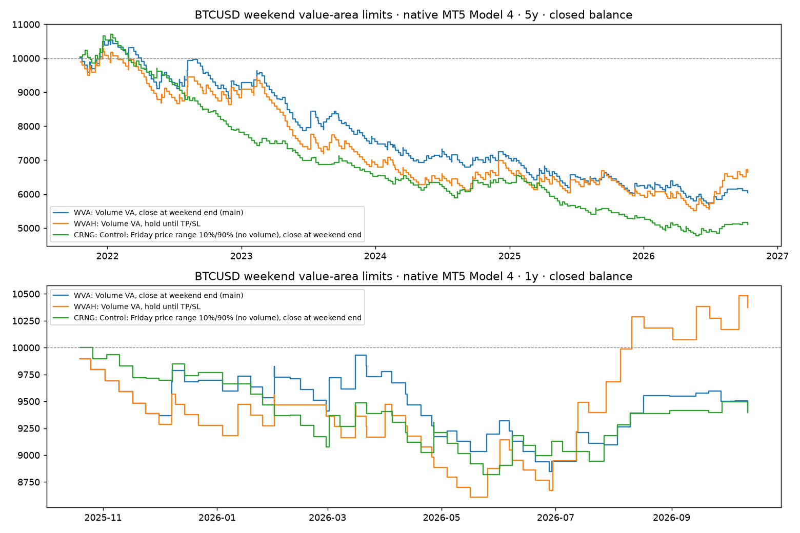

# BTCUSD weekend value-area limits — RAW test report (2026-10-18)

**Verdict: RAW GATE FAILED.** No version survives to optimisation.

- **Both volume-profile versions lose money** on the 3-year and 5-year windows, and their profit factors are well below 1.15.
- The volume levels **do** beat the plain price-range control, but that only means they lose less.
- The hold-until-TP/SL version (WVAH) is profitable over the last 6 months (+12.99%, PF 1.72, 27 trades) and the last year (+3.75%, PF 1.09).
  - Every full calendar year from 2022 to 2025 lost money for all three versions.
  - So the recent gain is one short regime, not evidence of an edge.

Research only. Nothing was installed, attached, deployed or pushed:
- No live or Ava terminal was touched.
- No SET was replaced.

## What was tested

The rules were frozen before the first run; see [RULES.md](RULES.md). They come from your idea and the TradingView FRVP screenshots: Row Size 128 ("Number of rows") and Value Area Volume 80%.

- **Levels:** after each Friday (00:00–24:00 UTC), build that day's volume profile from M1 tick volume. It has 128 equal rows, and the value area grows from the POC to 80%.
- **Orders:** from the first weekend tick, place a **buy limit at VAL** and a **sell limit at VAH**.
  - Each targets the **opposite edge**.
  - The stop is **1/3 of the VA width** beyond the entry, giving 1:3 RR.
  - Both sides may fill (no OCO), with at most one fill per side per weekend.
- **Versions:**
  - **WVA** (main): unfilled orders are cancelled and open positions closed at Monday 00:00 UTC.
  - **WVAH**: the same, but positions are held until TP or SL (declared before testing).
  - **CRNG** (control): WVA rules with the levels replaced by Friday's price-range 10%/90% points, so no volume is used.
- **Setup:**
  - Native MT5 Model 4 on the isolated tester (Exness-MT5Trial16 BTCUSD), 150 ms delay.
  - Broker spread, commission and swap.
  - $10,000 per separate run.
  - **1% equity risk per order**, lots rounded up to the step.
  - The windows all end on 2026-10-13 (exclusive).

## Results

Metric definitions:
- **/day** is per calendar day (BTC trades at weekends); **/weekend** is per Friday→weekend cycle in the window.
- **Consistency** is the share of calendar months that were profitable.
- **Sharpe** is annualised from daily returns (√365).
- **Bal DD** is the closed-balance drawdown from the ledger; **Eq DD** is the floating-equity drawdown from the MT5 report.
- **Mean R** is net P&L per trade divided by 1% of the balance before the trade.
- **Exits:** the last column counts take-profit, stop-loss and the forced Monday 00:00 close (WVA/CRNG only).

{{MAIN}}

### Gate (PIPELINE.md stage 4, predeclared in run-config.json)

| Version | Window | Positive | PF ≥ 1.15 | ≥ 30 trades | Beats control (PF and mean R) | Clean execution |
|---|---|---|---|---|---|---|
{{GATE}}

### Year by year (5y runs)

{{YEARS}}

### Long vs short

{{SIDES}}

### Why it loses (5y diagnostics)

{{DIAG}}

- **It is not a cost problem.** The trades already lose before costs. WVA 5y gross is about −$3.4k, against −$0.5k of commission.
- **The stop is too tight for weekend noise, and the full-width target is rarely reached.**
  - Of WVA's 296 trades over 5 years, 193 hit the stop (65%) and only 34 hit the opposite edge (11.5%).
  - At 3R the break-even TP rate is about 25%.
  - The forced Monday closes are mostly winners (56 of 69, +$3.9k): price often moves the right way but does not cross the whole value area within ~48 h.
  - The median Friday value area is about **2.3% of price** (volume version) and 3.1% (range control). The stop (VA width / 3) is therefore only about 0.77% of price.
- **Holding longer (WVAH) does not fix it.**
  - The win rate drops to 22.5% over 5 years, below the 25% break-even.
  - It produced a 24-trade losing streak and one position held for about 615 hours.
- **The two sides behave very differently.**
  - Over the 5- and 3-year windows the long side (buy at VAL) is about flat to positive, and the short side carries almost all the loss.
  - This was seen *after* the test. A long-only filter is therefore not a valid rescue without a new, predeclared test.
- **No OCO** means both sides filled on 56 of the 240 weekends with a fill, so up to 2% was at risk on those weekends.

## Survivor recommendation for optimisation

**None.**
- Under PIPELINE.md a raw failure stops here, so there is no optimisation or Monte Carlo of a losing rule set.
- The control comparison and the positive last 6 months are not enough to override that.

If you still want to explore it, that would need an explicit **exploratory override** from you, as was done for Nasdaq H1 on 2026-09-29.

- **What the evidence points to (new, predeclared dimensions):**
  - a wider stop / lower RR, e.g. 1:1–1:2 instead of a stop at 1/3 of the width;
  - a nearer target (POC or VA midpoint) instead of the opposite edge;
  - possibly long-only.
- **Data split:**
  - This would use the amended split: development before 2023-10-13, validation 2023-10-13 → 2024-10-13, final OOS 2024-10-13 → 2026-10-13.
  - Every window has now been seen in this raw test, so the OOS would be **previously viewed history**, not an untouched holdout. It would be labelled that way.

<!-- best-day-dependence:start -->
## Best-day dependence (added 2026-10-20)

Rule (PIPELINE.md stage 4, 2026-10-20): a positive total FAILS if it turns ≤ 0 without its single best day or single best trade. The 5-best-days and worst-day columns are diagnostics.

| Run | Trades | Total $ | Best day | w/o best day $ | w/o best trade $ | w/o 5 best days $ | w/o worst day $ | Verdict |
|---|---:|---:|---|---:|---:|---:|---:|---|
| BTCUSD-CRNG-1y | 48 | -603 | 2026-03-01 +291 | -894 | -894 | -1,802 | -492 | **n/a (already ≤ 0)** |
| BTCUSD-CRNG-3y | 143 | -2,561 | 2025-01-19 +286 | -2,847 | -2,847 | -3,866 | -2,454 | **n/a (already ≤ 0)** |
| BTCUSD-CRNG-5y | 242 | -4,889 | 2021-12-19 +314 | -5,202 | -5,202 | -6,024 | -4,733 | **n/a (already ≤ 0)** |
| BTCUSD-CRNG-6m | 22 | +334 | 2026-06-07 +310 | +24 | +24 | -709 | +443 | **PASS** |
| BTCUSD-WVA-1y | 58 | -592 | 2025-12-07 +315 | -908 | -908 | -1,993 | -390 | **n/a (already ≤ 0)** |
| BTCUSD-WVA-3y | 175 | -2,528 | 2024-12-01 +272 | -2,801 | -2,808 | -3,751 | -2,338 | **n/a (already ≤ 0)** |
| BTCUSD-WVA-5y | 296 | -3,954 | 2022-08-07 +563 | -4,517 | -4,261 | -5,700 | -3,756 | **n/a (already ≤ 0)** |
| BTCUSD-WVA-6m | 27 | -64 | 2026-07-12 +284 | -348 | -348 | -1,008 | +41 | **n/a (already ≤ 0)** |
| BTCUSD-WVAH-1y | 55 | +375 | 2026-10-07 +312 | +63 | +63 | -1,152 | +570 | **PASS** |
| BTCUSD-WVAH-3y | 172 | -1,195 | 2025-01-20 +286 | -1,481 | -1,481 | -2,587 | -1,007 | **n/a (already ≤ 0)** |
| BTCUSD-WVAH-5y | 293 | -3,352 | 2022-08-07 +538 | -3,890 | -3,658 | -5,095 | -3,158 | **n/a (already ≤ 0)** |
| BTCUSD-WVAH-6m | 27 | +1,299 | 2026-10-07 +338 | +961 | +961 | -348 | +1,419 | **PASS** |
<!-- best-day-dependence:end -->

## Limitations

- **Volume is MT5 tick volume** on Exness's BTCUSD CFD (the count of price updates per M1 bar), not traded exchange volume.
  - TradingView's FRVP on an exchange feed uses real traded volume, and its exact value-area algorithm is not published, so its VAH/VAL can differ from ours.
  - Our levels were not checked side by side against TradingView.
- **Tick data:**
  - Real ticks begin on 2026-01-01. Earlier ticks are generated by MT5, which covers the first ~2.5 months of the 1y window and almost all of the 3y and 5y windows.
  - The 6m window is fully real-tick.
- **Defaults we chose:** Friday is the UTC calendar day, and the weekend ends at Monday 00:00 UTC. Other session definitions would give different levels.
- **Sizing:** rounding lots up to the lot step can push the risk slightly above 1%. No order was below the minimum or skipped for margin.
- **Evidence type:** each run is a standalone single-strategy native test, not a portfolio or shared-account test.

## Audit

- **12 main and control runs (4 windows × 3 versions), plus 1 smoke run:**
  - exit code 0;
  - expert, symbol, period and inputs verified in every native report;
  - no input mismatches.
- **Journal flags:** `init_failed`, `no_history`, `rejected`, `size_below_min` and `critical` are all 0.
- **EA counters:** `place_fails`, `close_fails`, `cancel_fails`, `skipped_risk` and `no_levels` are all 0. Levels were computed for every weekend (26 / 52 / 157 / 261).
- **Ledgers:** partial FIFO fragments were recombined by exit deal, using the same parser fix as Recent EA Shortlist 2026-09-30.
- **Hashes:**
  - EA source `BTC Weekend Value Area Research EA.mq5`: sha256 `d841376a0a98…e98ce9`.
  - EX5: `4e18cb6f63bc…e85b95` (0 errors, 0 warnings).

## Files

- **Inputs:** [RULES.md](RULES.md), [run-config.json](run-config.json), [EA/](EA/).
- **Native evidence:** `native/nw-BTCUSD-*/` holds the run.json, report, SET, tester.ini, journal and ledger for each run.
- **Outputs:** [RESULTS.json](RESULTS.json), [RESULTS.md](RESULTS.md) (analysis output), [balance.png](balance.png).
- **Scripts:**
  - [run.py](run.py): the harness, which reuses `No Wick Candle Raw 2026-09-25/run_nw.py`.
  - [analyse.py](analyse.py): the analysis; run with `uv run --with matplotlib` from `AAA EAs/EA store`.
  - [make_report.py](make_report.py): builds this report.
