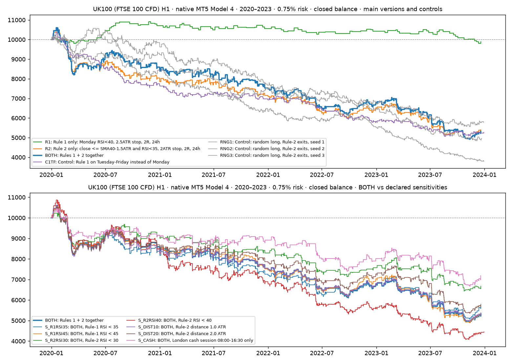

# FTSE 100 Monday dip + stretch-below-mean — RAW test report, 2020–2023 (2026-10-19)

**Verdict: RAW GATE FAILED.** Rule 1, Rule 2 and both rules together all lose money over 2020–2023. No version survives to optimisation.

- **Rule 2 is no better than random.** "Far below the 40-hour average, RSI < 35" does about as well as random long entries with the same exits:
  - Rule 2 alone: PF 0.77.
  - Random-entry controls: PF 0.65–0.77.
- **Rule 1 (Monday dip) is flat to slightly negative:** −1.02%, PF 0.97, 104 trades.
  - It does beat the same rule run Tuesday–Friday (PF 0.65), so Mondays are relatively better.
  - It made money only in 2020 (+7.11%) and lost in 2021, 2022 and 2023.
  - It is slightly positive before commission and swap: +$197 gross against −$299 of costs.
- **All seven declared threshold changes also lose** (−28% to −55%), and none has a single positive year.
  - The clip says "results hold when thresholds move". Here they do hold, but only as losses.

Research only. Nothing was installed, attached, deployed or pushed:
- No live or Ava terminal was touched.
- 2024–2026 was not run, so that period stays unseen.

## What was tested

The rules come from the clip pasted by the user and were frozen before the first run; see [RULES.md](RULES.md).

- **Instrument and signals:** `UK100` (Exness FTSE 100 CFD), H1 signals on the closed bar, market buy on the next bar.
- **Rule 1:** on a London Monday, if RSI(14) < 40, buy.
  - Stop 2.5 ATR(14), target 2R, exit after 24 h.
  - At most one entry per Monday.
- **Rule 2:** if close ≤ SMA(40) − 1.5 ATR and RSI < 35, buy.
  - Stop 2 ATR, target 2R, exit after 24 h.
- **Positions:** one open position per rule.
- **Setup:**
  - Native MT5 Model 4, 150 ms delay, $10,000 USD, broker spread, commission and swap.
  - **0.75% equity risk per trade**, as in the clip, with lots rounded up.
  - Window 2020-01-01 → 2024-01-01 (exclusive).
- **Not tested:** the clip's "third rule inside the bot" is not disclosed.

Metric definitions:
- **/day** is per weekday.
- **Consistency** is the share of the 48 calendar months that were profitable.
- **Sharpe** is annualised from daily returns (√252).
- **Bal DD** is the closed-balance drawdown from the ledger; **Eq DD** is the floating-equity drawdown from the MT5 report.
- **Mean R** is net P&L per trade divided by 0.75% of the balance before it.

## Main versions

| Version | Trades | /month | /day | Return | PF | Win % | Consistency | Avg win / loss streak (max) | Sharpe | Bal DD | Eq DD | Mean R | Exits TP / SL / 24h |
|---|---:|---:|---:|---:|---:|---:|---:|---|---:|---:|---:|---:|---|
| **R1** — Rule 1 only: Monday RSI<40, 2.5ATR stop, 2R, 24h | 104 | 2.17 | 0.1 | -1.02% | 0.97 | 43.3 | 43.8% | 1.8 / 2.46 (10 / 6) | -0.04 | 10.14% | 11.14% | -0.009 | 7 / 46 / 51 |
| **R2** — Rule 2 only: close <= SMA40-1.5ATR and RSI<35, 2ATR stop, 2R, 24h | 597 | 12.44 | 0.572 | -46.02% | 0.77 | 38.0 | 35.4% | 1.76 / 2.89 (6 / 14) | -1.18 | 53.54% | 53.62% | -0.132 | 92 / 327 / 178 |
| **BOTH** — Rules 1 + 2 together | 701 | 14.6 | 0.672 | -46.75% | 0.8 | 38.8 | 31.2% | 1.83 / 2.9 (7 / 11) | -1.09 | 53.61% | 54.0% | -0.115 | 99 / 373 / 229 |

## Controls

| Version | Trades | /month | /day | Return | PF | Win % | Consistency | Avg win / loss streak (max) | Sharpe | Bal DD | Eq DD | Mean R | Exits TP / SL / 24h |
|---|---:|---:|---:|---:|---:|---:|---:|---|---:|---:|---:|---:|---|
| **C1TF** — Control: Rule 1 on Tuesday-Friday instead of Monday | 455 | 9.48 | 0.436 | -47.37% | 0.65 | 38.7 | 25.0% | 1.56 / 2.49 (5 / 15) | -1.83 | 51.05% | 51.13% | -0.184 | 36 / 228 / 191 |
| **RNG1** — Control: random long, Rule-2 exits, seed 1 | 559 | 11.65 | 0.536 | -42.28% | 0.77 | 38.6 | 31.2% | 1.64 / 2.6 (6 / 12) | -1.27 | 45.75% | 46.48% | -0.126 | 74 / 284 / 201 |
| **RNG2** — Control: random long, Rule-2 exits, seed 2 | 585 | 12.19 | 0.561 | -50.43% | 0.76 | 37.3 | 25.0% | 1.61 / 2.74 (6 / 9) | -1.52 | 54.21% | 54.68% | -0.155 | 82 / 321 / 182 |
| **RNG3** — Control: random long, Rule-2 exits, seed 3 | 591 | 12.31 | 0.567 | -62.02% | 0.65 | 34.7 | 22.9% | 1.45 / 2.74 (8 / 12) | -2.26 | 62.51% | 62.89% | -0.214 | 65 / 319 / 207 |

Random-entry control mean (RNG1–3): PF 0.73, mean R -0.165, return -51.58%.

## Year by year

| Version | 2020 | 2021 | 2022 | 2023 | Positive years |
|---|---|---|---|---|---:|
| R1 | +7.11% (PF 1.82, n30) | -1.38% (PF 0.87, n26) | -1.25% (PF 0.83, n21) | -5.11% (PF 0.57, n27) | 1/4 |
| R2 | -21.47% (PF 0.69, n163) | -9.60% (PF 0.83, n134) | -8.18% (PF 0.85, n139) | -17.19% (PF 0.75, n161) | 0/4 |
| BOTH | -16.05% (PF 0.8, n193) | -10.91% (PF 0.84, n160) | -9.30% (PF 0.85, n160) | -21.51% (PF 0.73, n188) | 0/4 |
| C1TF | -23.79% (PF 0.5, n113) | -9.21% (PF 0.76, n107) | -15.86% (PF 0.64, n112) | -9.59% (PF 0.8, n123) | 0/4 |
| RNG1 | -7.69% (PF 0.86, n140) | -18.86% (PF 0.64, n132) | -9.91% (PF 0.82, n138) | -14.46% (PF 0.76, n149) | 0/4 |
| RNG2 | -3.78% (PF 0.94, n143) | -20.23% (PF 0.68, n154) | -15.96% (PF 0.73, n142) | -23.15% (PF 0.62, n146) | 0/4 |
| RNG3 | -16.30% (PF 0.71, n136) | -24.25% (PF 0.62, n161) | -12.96% (PF 0.78, n151) | -31.17% (PF 0.49, n143) | 0/4 |

## Declared sensitivity (BOTH with one threshold moved; not used to pick a winner)

| Version | Trades | /month | /day | Return | PF | Win % | Consistency | Avg win / loss streak (max) | Sharpe | Bal DD | Eq DD | Mean R | Exits TP / SL / 24h |
|---|---:|---:|---:|---:|---:|---:|---:|---|---:|---:|---:|---:|---|
| **S_R1RSI35** — BOTH, Rule-1 RSI < 35 | 662 | 13.79 | 0.635 | -43.00% | 0.8 | 39.6 | 33.3% | 2.0 / 3.08 (7 / 15) | -0.95 | 52.13% | 52.54% | -0.108 | 100 / 354 / 208 |
| **S_R1RSI45** — BOTH, Rule-1 RSI < 45 | 732 | 15.25 | 0.702 | -46.45% | 0.81 | 40.3 | 29.2% | 1.9 / 2.84 (8 / 11) | -1.07 | 53.68% | 53.89% | -0.109 | 100 / 387 / 245 |
| **S_R2RSI30** — BOTH, Rule-2 RSI < 30 | 454 | 9.46 | 0.435 | -33.22% | 0.8 | 39.2 | 43.8% | 1.73 / 2.71 (5 / 10) | -0.88 | 37.33% | 37.85% | -0.113 | 60 / 238 / 156 |
| **S_R2RSI40** — BOTH, Rule-2 RSI < 40 | 908 | 18.92 | 0.871 | -55.46% | 0.8 | 38.1 | 35.4% | 1.74 / 2.84 (7 / 12) | -1.2 | 62.49% | 62.95% | -0.114 | 131 / 483 / 294 |
| **S_DIST10** — BOTH, Rule-2 distance 1.0 ATR | 707 | 14.73 | 0.678 | -46.19% | 0.8 | 39.0 | 31.2% | 1.85 / 2.91 (7 / 11) | -1.06 | 53.11% | 53.94% | -0.112 | 100 / 375 / 232 |
| **S_DIST20** — BOTH, Rule-2 distance 2.0 ATR | 681 | 14.19 | 0.653 | -42.00% | 0.82 | 39.6 | 35.4% | 1.86 / 2.85 (7 / 11) | -0.95 | 49.09% | 49.53% | -0.101 | 96 / 358 / 227 |
| **S_CASH** — BOTH, London cash session 08:00-16:30 only | 520 | 10.83 | 0.499 | -28.08% | 0.85 | 39.2 | 43.8% | 1.73 / 2.7 (6 / 12) | -0.64 | 36.11% | 36.66% | -0.079 | 85 / 274 / 161 |

| Version | 2020 | 2021 | 2022 | 2023 | Positive years |
|---|---|---|---|---|---:|
| S_R1RSI35 | -18.26% (PF 0.76, n181) | -11.91% (PF 0.81, n149) | -5.94% (PF 0.9, n155) | -15.83% (PF 0.79, n177) | 0/4 |
| S_R1RSI45 | -17.41% (PF 0.78, n195) | -9.69% (PF 0.86, n170) | -5.74% (PF 0.91, n171) | -23.84% (PF 0.7, n196) | 0/4 |
| S_R2RSI30 | -9.96% (PF 0.81, n127) | -8.00% (PF 0.82, n110) | -8.57% (PF 0.76, n90) | -11.83% (PF 0.79, n127) | 0/4 |
| S_R2RSI40 | -16.92% (PF 0.83, n236) | -18.36% (PF 0.79, n222) | -17.33% (PF 0.77, n200) | -20.58% (PF 0.8, n250) | 0/4 |
| S_DIST10 | -17.38% (PF 0.78, n195) | -9.29% (PF 0.86, n162) | -9.11% (PF 0.85, n161) | -21.01% (PF 0.74, n189) | 0/4 |
| S_DIST20 | -15.15% (PF 0.81, n189) | -8.01% (PF 0.88, n157) | -6.91% (PF 0.88, n153) | -20.17% (PF 0.74, n182) | 0/4 |
| S_CASH | -9.26% (PF 0.83, n129) | -1.75% (PF 0.96, n125) | -10.09% (PF 0.77, n111) | -10.29% (PF 0.85, n155) | 0/4 |

## Gate (predeclared in RULES.md)

| Version | Positive | PF ≥ 1.15 | ≥ 30 trades | ≥ 3/4 years positive | Beats control | Clean | Verdict |
|---|---|---|---|---|---|---|---|
| R1 | **no** | **no** | yes | **no** | yes | yes | **FAIL** |
| R2 | **no** | **no** | yes | **no** | yes | **no** | **FAIL** |
| BOTH | **no** | **no** | yes | **no** | yes | **no** | **FAIL** |

- **Beats control** is technically "yes" for R2 and BOTH: PF 0.77 / 0.80 against a random mean of 0.73. But one random seed (RNG1) matches R2's PF exactly, so this is not a meaningful edge.
- **Clean** is "no" for R2 and BOTH: 2 of 599 Rule-2 signals fell in a bar where trading was closed, and the market buy was rejected and skipped. This does not change the conclusion.

## Costs and holding

| Run | Gross P&L $ (incl. spread at fills) | Commission + swap $ | Net $ | Mean hold h | Weekend-gap time exits |
|---|---:|---:|---:|---:|---:|
| R1 | +197 | -299 | -102 | 15.4 | 0 |
| R2 | -3,173 | -1,430 | -4,602 | 16.5 | 58 |
| BOTH | -2,974 | -1,701 | -4,675 | 16.3 | 58 |
| C1TF | -3,685 | -1,052 | -4,737 | 20.8 | 55 |
| RNG1 | -2,596 | -1,632 | -4,228 | 18.0 | 57 |
| RNG2 | -3,306 | -1,737 | -5,043 | 17.2 | 49 |
| RNG3 | -4,682 | -1,520 | -6,202 | 18.8 | 65 |

- **Rule 2 loses before costs:** gross −$3.2k. Commission and overnight swap add another −$1.4k.
- **Rule 1's small gross profit is wiped out by costs.**
- **Weekend gaps:** a Friday entry that is still open after 24 h closes at the Sunday 22:05 reopen. This happened 58 times for Rule 2.

## Signal and execution counters (EA journal)

| Run | H1 bars | R1 signals / entries | R2 signals / entries | R2 flat bars | Random entries | Skipped (stops / margin) | Place / close fails |
|---|---:|---|---|---:|---:|---|---|
| R1 | 22094 | 104 / 104 | 0 / 0 | 0 | 0 | 0 / 0 | 0 / 0 |
| R2 | 22094 | 0 / 0 | 599 / 597 | 16525 | 0 | 0 / 0 | 2 / 0 |
| BOTH | 22094 | 104 / 104 | 599 / 597 | 16525 | 0 | 0 / 0 | 2 / 0 |
| C1TF | 22094 | 458 / 455 | 0 / 0 | 0 | 0 | 0 / 0 | 3 / 0 |
| RNG1 | 22094 | 0 / 0 | 0 / 0 | 0 | 559 | 0 / 0 | 6 / 0 |
| RNG2 | 22094 | 0 / 0 | 0 / 0 | 0 | 585 | 0 / 0 | 4 / 0 |
| RNG3 | 22094 | 0 / 0 | 0 / 0 | 0 | 591 | 0 / 0 | 2 / 0 |
| S_R1RSI35 | 22094 | 65 / 65 | 599 / 597 | 16525 | 0 | 0 / 0 | 2 / 0 |
| S_R1RSI45 | 22094 | 135 / 135 | 599 / 597 | 16525 | 0 | 0 / 0 | 2 / 0 |
| S_R2RSI30 | 22094 | 104 / 104 | 351 / 350 | 18933 | 0 | 0 / 0 | 1 / 0 |
| S_R2RSI40 | 22094 | 104 / 104 | 807 / 804 | 14357 | 0 | 0 / 0 | 3 / 0 |
| S_DIST10 | 22094 | 104 / 104 | 605 / 603 | 16433 | 0 | 0 / 0 | 2 / 0 |
| S_DIST20 | 22094 | 104 / 104 | 579 / 577 | 16609 | 0 | 0 / 0 | 2 / 0 |
| S_CASH | 22094 | 83 / 83 | 437 / 437 | 7390 | 0 | 0 / 0 | 0 / 0 |

## Compared with the clip

| | Clip (since 2017, three rules) | This test (2020–2023, two disclosed rules, BOTH) |
|---|---|---|
| Trades per year | 1,908 / ~9.7 y ≈ 196 | 701 / 4 y ≈ 175 |
| Win rate | 50.8% | 38.8% |
| Return | +312.9% at 0.75% risk | −46.75% at 0.75% risk |
| Max DD | 12% | 54.0% equity |

The clip says its thresholds were chosen on the same years it tested, and its third rule is secret. Our data, cost model and gap-filling defaults also differ from theirs; see the limitations below. None of these explains a gap this large in Rule 2: it does no better than random entries.

## Survivor recommendation for optimisation

**None.**
- Under PIPELINE.md a raw failure stops here.
- **Rule 1** is the only part with a relative effect (Monday beats Tuesday–Friday). But it is not profitable after costs, makes about 2 trades a month, and was positive in only 1 of 4 years.
- The clip also claims the Monday dip appears on the DAX, S&P 500 and Nasdaq. A separate raw test of Rule 1 alone on those indices would be the only follow-up worth considering, and it would need your request.

<!-- best-day-dependence:start -->
## Best-day dependence (added 2026-10-20)

Rule (PIPELINE.md stage 4, 2026-10-20): a positive total FAILS if it turns ≤ 0 without its single best day or single best trade. The 5-best-days and worst-day columns are diagnostics.

| Run | Trades | Total $ | Best day | w/o best day $ | w/o best trade $ | w/o 5 best days $ | w/o worst day $ | Verdict |
|---|---:|---:|---|---:|---:|---:|---:|---|
| UK100-BOTH-2020_2023 | 701 | -4,675 | 2020-01-07 +226 | -4,901 | -4,841 | -5,571 | -4,289 | **n/a (already ≤ 0)** |
| UK100-C1TF-2020_2023 | 455 | -4,737 | 2020-01-17 +148 | -4,885 | -4,885 | -5,432 | -4,566 | **n/a (already ≤ 0)** |
| UK100-R1-2020_2023 | 104 | -102 | 2021-09-06 +157 | -259 | -259 | -882 | -17 | **n/a (already ≤ 0)** |
| UK100-R2-2020_2023 | 597 | -4,602 | 2021-01-04 +171 | -4,773 | -4,770 | -5,395 | -4,301 | **n/a (already ≤ 0)** |
| UK100-RNG1-2020_2023 | 559 | -4,228 | 2020-04-17 +174 | -4,402 | -4,402 | -5,005 | -4,071 | **n/a (already ≤ 0)** |
| UK100-RNG2-2020_2023 | 585 | -5,043 | 2020-11-03 +247 | -5,290 | -5,200 | -6,054 | -4,825 | **n/a (already ≤ 0)** |
| UK100-RNG3-2020_2023 | 591 | -6,202 | 2021-03-26 +228 | -6,430 | -6,354 | -7,048 | -6,053 | **n/a (already ≤ 0)** |
| UK100-S_CASH-2020_2023 | 520 | -2,808 | 2021-06-21 +263 | -3,071 | -2,991 | -4,048 | -2,391 | **n/a (already ≤ 0)** |
| UK100-S_DIST10-2020_2023 | 707 | -4,619 | 2020-01-07 +226 | -4,845 | -4,785 | -5,525 | -4,232 | **n/a (already ≤ 0)** |
| UK100-S_DIST20-2020_2023 | 681 | -4,200 | 2020-01-07 +224 | -4,423 | -4,365 | -5,120 | -3,807 | **n/a (already ≤ 0)** |
| UK100-S_R1RSI35-2020_2023 | 662 | -4,300 | 2020-06-29 +265 | -4,565 | -4,468 | -5,437 | -3,982 | **n/a (already ≤ 0)** |
| UK100-S_R1RSI45-2020_2023 | 732 | -4,645 | 2021-01-04 +305 | -4,950 | -4,813 | -5,631 | -4,254 | **n/a (already ≤ 0)** |
| UK100-S_R2RSI30-2020_2023 | 454 | -3,322 | 2020-05-26 +177 | -3,499 | -3,499 | -4,110 | -3,020 | **n/a (already ≤ 0)** |
| UK100-S_R2RSI40-2020_2023 | 908 | -5,546 | 2020-11-24 +254 | -5,801 | -5,714 | -6,660 | -5,187 | **n/a (already ≤ 0)** |
<!-- best-day-dependence:end -->

## Limitations

- **Tick data:**
  - Real UK100 ticks start 2026-01-02, so the whole 2020–2023 window uses **MT5-generated ticks from M1 bars**.
  - Spreads come from the M1 bars.
  - Results can differ from real-tick execution.
- **Defaults we chose** for things the clip does not specify:
  - RSI/ATR period 14;
  - "far below" = 1.5 ATR;
  - "weak" = RSI < 40;
  - London Monday;
  - all broker hours, with the cash session tested as a sensitivity;
  - one position per rule.
- **Rule attribution inside BOTH:** when Rules 1 and 2 hold longs at the same time, the report parser pairs exits with entries first-in-first-out.
  - BOTH's totals, trade count and P&L are correct, because each exit deal's P&L is native.
  - Splitting BOTH's trades by rule is **not** reliable, so rule-level evidence comes from the standalone R1 and R2 runs.
- **Overlap with the validation window:** under the 2026-10-06 split rule (study end 2026-10-19), 2023-10-19 → 2023-12-31 belongs to the validation year and is now viewed. 2024–2026 was not run.
- **Evidence type:** each run is a standalone single-strategy native test on an Exness demo feed, not FTMO or another broker's execution.

## Audit

- **14 runs (3 main, 4 control, 7 sensitivity) plus 1 smoke run:**
  - exit code 0;
  - expert, symbol, period and inputs verified in every native report.
- **Journal flags:** `init_failed`, `no_history`, `size_below_min` and `critical` are all 0.
- **Market-closed rejections:** the `rejected` lines are market-closed entry rejects only (counted under place fails above). Close fails are 0 in every run.
- **Smoke-test fix:** the first smoke run showed time exits retrying while the market was closed. The EA was changed before the grid to wait for the broker trade session, and the smoke test was re-run clean. The final EA source and EX5 are the ones in `EA/`. Source sha256 `35c015debe5e63a90b61bad8e6da8d07fa017e91d10925026c4f9ea0194ceb63`, EX5 `af7354c2d8fbcbd298ce56566ebdc699ec44cd40602760e651d07002c09487cf` (0 errors, 0 warnings).
- **Random-control probability:** set by frequency matching only, p = R2 entries / R2 flat bars = 597 / 16,525 = 0.03613; see [RNG_FREQUENCY.json](RNG_FREQUENCY.json).

## Files

- **Inputs:** [RULES.md](RULES.md), [run-config.json](run-config.json), [EA/](EA/).
- **Native evidence:** `native/nw-UK100-*/` holds the run.json, report, SET, tester.ini, journal and ledger for each run.
- **Outputs:** [RESULTS.json](RESULTS.json), [RESULTS.md](RESULTS.md), [balance.png](balance.png).
- **Scripts:**
  - [run.py](run.py): the harness, which reuses `No Wick Candle Raw 2026-09-25/run_nw.py`.
  - [analyse.py](analyse.py): the analysis, which also builds this report from `REPORT.template.md`.
