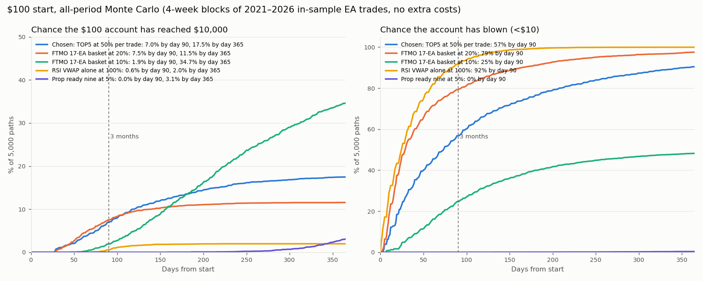

# Small Account 90 Day Search 2026-10-23 — can $100 reach $10,000 in 3 months?

Owner request: "run more deep simulation and find better approaches and what EAs to use to get there in 3 months if
possible (reach 10k in 3 months)", then "try RSI+VWAP EA only too with higher risk per trade".

This is a Python/numba replay of frozen native EA ledgers. No MT5 run, nothing installed, nothing live. The method was
predeclared in `PLAN.md`, including Addendum 1 for RSI VWAP, before any run. The split is in `SPLIT.json`; full tables
are in `RESULTS.md`.

## Verdict

- **Not realistic** by the predeclared rule. The pipeline's chosen configuration reached $10k within 90 days in
  **2.6% of OOS history starts and 3.6% of OOS Monte Carlo paths**. Within those 90 days it blew the $100 in
  **65–73%** of paths.
- **The best odds found, in any test, were about 1 in 7.** The all-period Monte Carlo gives 5–8%. Every tested
  configuration falls to 0–2% under a small extra-cost stress.
- **RSI VWAP alone cannot do it, even at 100% risk per trade.** It reached $10k in ≤0.6% of 90-day paths.
  - It trades only 3–5 times a month (about 13 trades in 3 months).
  - Its wins are small (the take profit is about 0.56R).
  - It lost slightly in 2021–2023.
- **Realistic timelines:**
  - 12 months, FTMO 17-EA basket at 10%: 29–35% reach $10k, but 48–69% blow up.
  - 2 years at 3–5% (previous study): about 50% reach $10k, with 0–6% blow-ups.

## The 90-day race: every evidence type

P($10k ≤ 90 d) is shown as MC / history; bust is the MC rate within 90 days.

| Configuration | Dev 2021–23 | Validation 2023–24 | OOS 2024–26 | All-period MC / hist | Stress MC | Bust (dev / val / OOS / all) | Trades / month | / day |
|---|---:|---:|---:|---:|---:|---:|---:|---:|
| **Chosen: TOP5 at 50% per trade** | 5.0% / 0.2% | 14.9% / 9.6% | **3.6% / 2.6%** | 6.6% / 2.6% | 1.8% | 50 / 49 / 65 / 58% | 15–17 | 0.5–0.6 |
| Development #1: GREEDY6 at 50% | 7.8% / 0.0% | 11.8% / 8.6% | 2.5% / 0.9% | 7.0% / 1.7% | 2.3% | 69 / 81 / 89 / 81% | 18–21 | 0.6–0.7 |
| RSI VWAP alone at 100% (owner idea) | 0.4% / 0.0% | 2.0% / 0.0% | 0.3% / 0.0% | 0.6% / 0.0% | 0.0% | 99 / 60 / 84 / 92% | 3–4 | 0.1 |
| FTMO 17-EA basket at 20% (baseline) | 0.1% / 0.0% | 4.0% / 0.0% | 26.7% / 28.8% | 7.4% / 12.4% | 0.3% | 95 / 83 / 57 / 79% | 81–88 | 2.7–2.9 |
| FTMO 17-EA basket at 10% (baseline) | 0.1% / 0.0% | 0.7% / 0.0% | 12.2% / 14.2% | 2.0% / 5.9% | 0.0% | 47 / 29 / 5 / 24% | 76–79 | 2.5–2.6 |
| Prop ready nine at 5% (baseline) | 0% / 0% | 0% / 0% | 0% / 0% | 0% (chart) | – | 0 / 0 / 0 / 0% | 35–41 | 1.1–1.4 |

How to read it:
- **Chosen:** the highest validation score among the development top 20 (per the plan). It was tested on OOS once.
- **Baselines:** fixed settings declared beforehand, not chosen by the search. The FTMO baselines' all-period
  rows were added after OOS for reporting only.
- **Stress:** every trade gets −0.05R of extra cost and every win is cut by 10%.
- **Trades/month and /day:** median trades taken by paths that did not blow up.
- **The OOS years were the best regime for almost every EA** (lane table below). That is why the plain 17-EA basket
  at 20% looks good in OOS (27–29%) while the same setting scored about 0% in 2021–23. The search cannot tell
  beforehand which regime the next 3 months will be.

The chart uses the same all-period MC with a 365-day horizon. Its day-90 values come from different random paths than
the 90-day run, so they differ by a few tenths of a percent.

## Which EAs the search picked (TOP5) and why

TOP5 = the five lanes with the highest development growth rate at Kelly sizing. Lanes that lost money in 2021–2023
were dropped automatically.

| Lane | Dev mean R | Val mean R | OOS mean R | Trades / month (OOS) | Caution |
|---|---:|---:|---:|---:|---|
| USDJPY London Open Momentum | +0.164 | +0.406 | +0.142 | 7.7 | – |
| US100 Selective ORB V3 | +0.266 | +0.324 | +0.460 | 0.3 | Only 15 development trades; failed the 1-year best-trade dependence audit |
| XAU Squeeze Momentum (standard) | +0.206 | +0.491 | +0.122 | 2.1 | – |
| 3 Way Gold module 930930101 | +0.116 | +0.086 | +0.187 | 4.5 | 3 Way Gold is labelled "watch only, failed older holdout" |
| 3 Way Gold module 930930102 | +0.159 | +0.364 | +0.167 | 0.9 | Same |

- **Concentration hurt in OOS.** Three of the five lanes weakened in OOS: USDJPY 0.41 → 0.14, Squeeze 0.49 → 0.12,
  3 Way Gold 930930102 0.36 → 0.17. Meanwhile lanes outside the TOP5 turned strongly positive (Nasdaq 5M +0.33,
  US100 Month End +0.33).
- **Greedy selection found the same core.** It added USDJPY, then 3 Way Gold 930930101 and 930930100, Squeeze,
  Selective ORB and 3 Way Gold 930930102, then stopped at 6 lanes.
- **Lanes with negative development edge** were never selected: RSI VWAP, Gold Overnight, Nasdaq 5M DI OFF,
  DMC XAU / US100, US100 H1 ORB, XAU Trend Progression, XAU London-NY ORB, Nasdaq Overnight, US100 Month End.
  Most turned positive in validation (not Gold Overnight, Nasdaq 5M DI OFF or XAU London-NY ORB), and all were
  positive in OOS.

## What else was tried (2,940 development configurations)

- **Baskets:**
  - Declared: Nasdaq 5M, Prop ready nine, FTMO 17, FTMO 17 with DI OFF, ORB five, RSI VWAP alone.
  - TOP-k for k = 1–10. Only 10 lanes had positive development edge, so TOP12/15 do not exist.
  - Greedy 1–6.
- **Sizing:**
  - Fixed 3–100% per trade.
  - Kelly multiples 0.5–3×.
  - 30 "deadline" policies that bet more when behind schedule and less when ahead.
- **Open-risk caps:** none, 30% or 60%.
- **Findings:**
  - **Only very high risk can reach the target.** Every development top-20 configuration risks 40–100% per trade
    (or deadline sizing up to 50%). In development, below about 20% risk it essentially never happened (FTMO 17 at 10%: 0.05%). In the
    strong OOS regime the 17-EA basket at 10% did it 12–14% of the time.
  - **Open-risk caps never helped.** They cut the variance this goal depends on.
  - **Deadline sizing helped a little.** It was the best in validation for GREEDY6 (13.7%), but was not the chosen one
    under the predeclared rule.
- **Reloading after a blow-up** (re-deposit $100) raises the 90-day odds only from 6.6% to about 8.5% for the chosen
  configuration. That costs about **$1,500–2,200 deposited per success**, because later attempts have less time
  left.

## Better approaches than a 3-month sprint

| Goal | Setting (same in-sample EA streams) | Reach $10k | Blow-up | Median days to $10k | Trades / month |
|---|---|---:|---:|---:|---:|
| 12 months | FTMO 17-EA basket at 10% | 34.7% MC / 29.3% hist | 48% / 69% | 208 | 82 |
| 2 years (previous study) | FTMO 17-EA basket at 3% | 46.3% MC / 49.0% hist | 0% / 0% | 576 / 532 | 64–71 |
| 2 years (previous study) | Prop ready nine at 5% | 50.2% MC / 49.6% hist | 1.2% / 5.8% | 563 / 502 | 39 |

- **Prop challenge route** (not your own $10k):
  - The FTMO, Current 14, Prop ready and Best Prop portfolios passed a 2-step challenge within 180 days in 49–81% of
    Monte Carlo paths at 0.5–1% risk (`Portfolio Prop Comparison 2026-10-22`, in-sample). ORB-only fails.
  - Payouts are a profit share of a funded account.
  - A small challenge usually costs on the order of this $100 budget; check the firm's current price.

## Disclosures

- **In-sample EAs.** The EAs and settings were chosen by earlier studies that saw this history. The split protects
  only the basket and sizing choice.
- **OOS is not pristine.** It was previously viewed in aggregate (`Small Account Challenge 2026-10-23`).
- **Few independent 90-day windows:** about 8 in development, 4 in validation and 8 in OOS. History percentages swing
  on one or two lucky windows.
- **Ticks before 2026 are generated.** Gaps and slippage appear only as recorded. Floating equity and stop-out are not
  modelled.
- **Risk of 50–100% per trade** means one bad gap or a missed stop ends the attempt. Lot sizes late in a winning path
  assume fills the broker may not give.
- **Production EAs cap risk at 1%** (Nasdaq 5M confirmed) and the Calyx BAT sizing rounds UP. Any high-risk version
  would need a separate research build; none was built.
- Not a forecast and not advice.

## Files

- `PLAN.md` (+ Addendum 1), `SPLIT.json`, `search.py` (dev / validate / oos / final / table).
- `PARITY.json`: the kernel equals `../Small Account Challenge 2026-10-23/sim.py` to the cent on 4 × 782 paths when
  both use the same cent rounding. With Python's own rounding the aggregate rates are identical.
- `DEV.json`, `VALIDATION.json`, `OOS.json` (run once), `FINAL.json`, `RESULTS.md`, `chart.py` →
  `CHART-TIME-TO-10K.png`.
